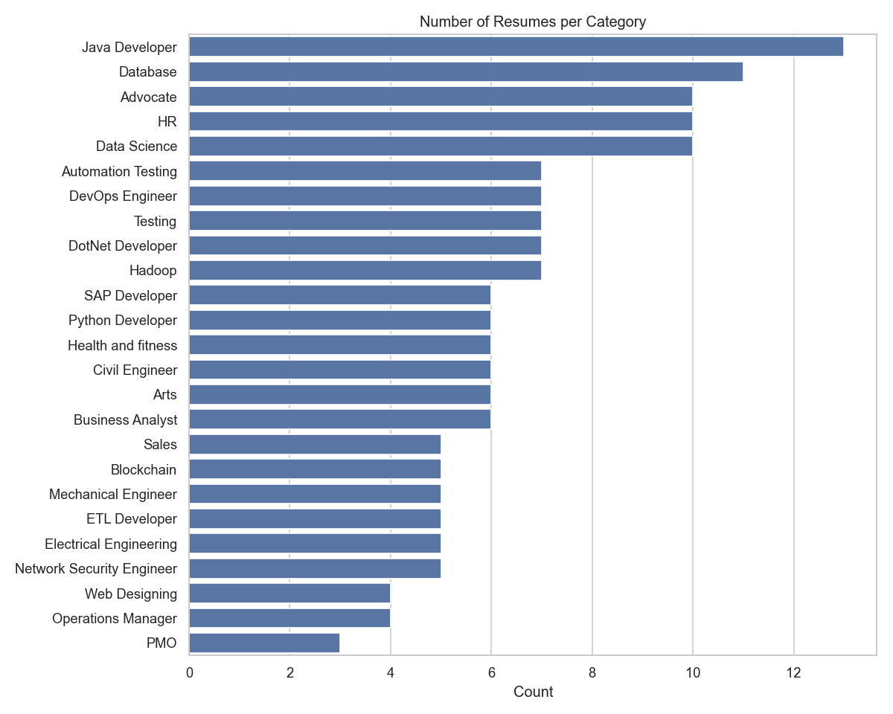
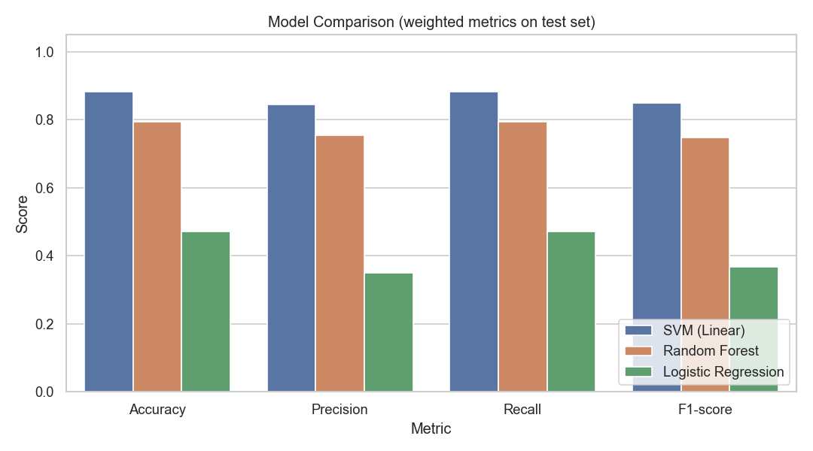
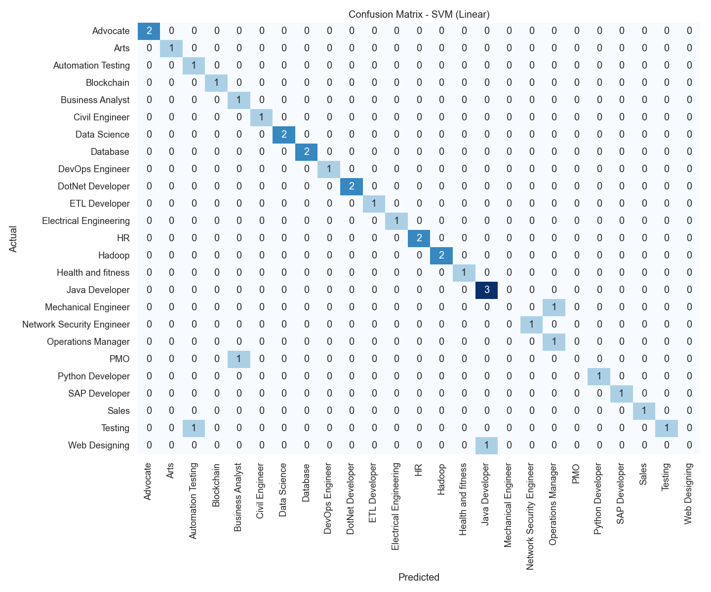

# Resume Classification using NLP

Automatically classifies a resume into a job category (Data Science, HR, Java Developer, Testing, Web Designing, …) using **TF-IDF** text features and three machine learning models, and selects the best one using standard classification metrics.

**Tech stack:** Python · pandas · NumPy · scikit-learn · Seaborn · Matplotlib

## How it works

| Step | What happens |
|---|---|
| 1. Load data | Resume dataset with `Category` and `Resume` columns |
| 2. Text cleaning | Lowercase, remove URLs, emails, numbers, special characters and stopwords |
| 3. EDA | Category distribution (class balance) and resume length by category, plotted with Seaborn |
| 4. Label encoding | Category names → numbers with `LabelEncoder` |
| 5. Train/test split | 80/20, **stratified** so every category is in both sets |
| 6. Feature extraction | **TF-IDF** (unigrams + bigrams, 5,000 features), fitted on training data only to avoid leakage |
| 7. Model training | Logistic Regression, Linear SVM, Random Forest |
| 8. Evaluation | Accuracy, precision, recall, F1-score (weighted) and a confusion matrix |
| 9. Model selection | Best model by F1-score is saved and used for predictions |

## Project structure

```
resume-classifier/
├── images/            # plots and results table saved by the notebook
├── models/            # saved best model
├── resume_classification.ipynb   # full pipeline: cleaning → EDA → TF-IDF → training → evaluation → prediction
├── UpdatedResumeDataSet.csv      # dataset (not uploaded; download link below)
└── requirements.txt
```

## How to run

1. Install the libraries: `pip install -r requirements.txt`
2. Download the dataset and place `UpdatedResumeDataSet.csv` next to the notebook:
   [UpdatedResumeDataSet.csv (Hugging Face)](https://huggingface.co/datasets/Unknown92/Resume_dataset/resolve/main/UpdatedResumeDataSet.csv)
3. Start Jupyter: `jupyter notebook`, open `resume_classification.ipynb`, then **Kernel → Restart & Run All**

## Results

The raw dataset contains many duplicate resumes. After removing duplicates, **166 unique resumes across 25 categories** remain. Keeping duplicates would put identical resumes in both the training and test sets and inflate the scores.

Because a single 80/20 split leaves only 1–3 test resumes per category, models were compared using **3-fold stratified cross-validation** (TF-IDF fitted inside each fold):

| Model | CV Accuracy | CV F1 (weighted) | F1 std |
|---|---|---|---|
| **SVM (Linear)** | **0.874** | **0.853** | 0.061 |
| Random Forest | 0.748 | 0.709 | 0.065 |
| Logistic Regression | 0.398 | 0.307 | 0.047 |

**Linear SVM performed best** and is the saved model. Logistic Regression underfits with default regularisation on this small, many-class dataset; increasing `C` is a possible improvement.

### Category distribution


### Model comparison


### Confusion matrix (best model)


## Key decisions

- **TF-IDF instead of word counts:** words common to every resume (e.g. "experience", "project") get low weight, while category-specific words (e.g. "selenium", "payroll") get high weight.
- **Duplicates removed + cross-validation:** prevents data leakage and gives a more reliable estimate than one small test split.
- **Stratified split:** some categories have far fewer resumes, so stratifying keeps them represented in the test set.
- **Weighted F1 rather than accuracy alone:** the classes are imbalanced, so F1 shows whether smaller categories are being classified correctly too.
- **Vectorizer fitted on training data only:** fitting on the full dataset would leak test-set vocabulary into training.
